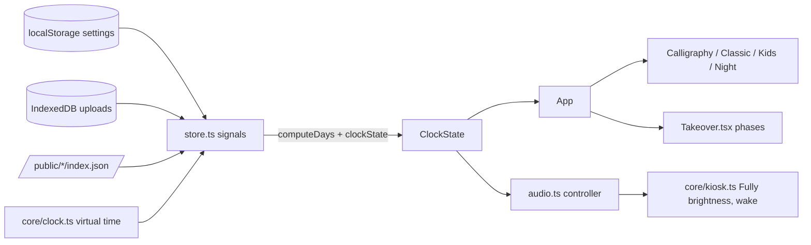

# Adhan Clock — maintainer notes

Static Vite + Preact + TypeScript app; see README.md for what it does.
Firebase project `adhan-clock-fs` belongs to faisal.shah@gmail.com (pass
`--account faisal.shah@gmail.com` to firebase/gcloud; another account is the
CLI default). Deploys go through GitHub Actions (WIF provider
`projects/727253655931/locations/global/workloadIdentityPools/github/providers/github`,
service account `github-deployer@adhan-clock-fs.iam.gserviceaccount.com`).
The GitHub repo is `faisal-shah/adhan-clock` (public); the default `gh`
account on this machine is a different user, so use
`GH_TOKEN=$(gh auth token --user faisal-shah)`.

## Architecture

- `src/core/schedule.ts` is the heart: a pure function from (now, three days
  of prayer times, settings, athan lengths, dismissed ids) to `ClockState` —
  current/next prayer, countdown, period, takeover phase, theme. Everything
  time-based is derived here and unit-tested in `tests/unit/schedule.test.ts`
  (run with `TZ=America/Chicago`; `npm test` sets it).
- Takeover phases are time windows, not timers: `pre` [athan−60 s, athan),
  `athan` [athan, athan+recording length), `dua` 75 s, `iqamah`
  [iqamah−60 s, iqamah). A reload mid-athan rejoins the recording at the right
  offset (`audio.ts`).
- `core/clock.ts` reads `?now=` / `?speed=`; settings previews call
  `travelTo()`, which also raises the preview bar.
- Settings are parsed at the localStorage boundary by `sanitizeSettings`
  (type-checked overlay onto defaults, enum validation, place validation).
  Inside the app, settings are trusted.

## Layout system

Each theme is drawn on a 1600×1000 design canvas: `html { font-size:
min(0.625vw, 1vh) }`, so `1rem` = 10 design px. Use rem for everything inside
themes; anchor to viewport edges so other aspect ratios still look right.
Large single-line text (clocks) needs `line-height` on the *container* too,
or the parent's strut (Poppins, normal line-height) inflates the box.

## Visual verification

Run the dev server in tmux (`tmux new -d -s adhan-dev 'npx vite --port 5173
--host 127.0.0.1'`) and render scenarios with `tests/visual/shoot.mjs` at
1280×800 (`W`, `H`, `DPR`, `WAIT` env vars). Look at the PNGs; the Playwright
suite only proves things render without errors.

## Content sets

- `public/calligraphy/index.json`: artwork by id. Period ids (`fajr`, `dhuhr`,
  ...) replace the font in `Calligraphy`; phrase ids (`bismillah`, `eid`,
  `ramadan`, `jumuah-mubarak`, `fajr-call`) are looked up with `findArt` /
  `Phrase`; `kind: "gallery"` pieces join the Gallery rotation. Everything
  degrades to the Ruqaa font when a piece is missing.
- `public/gallery/index.json`: photos with `fit` (`cover` scenes, `contain`
  museum objects shown over a blurred copy) and captions from the source
  records. The Gallery order is a per-day seeded shuffle.

## Gotchas

- Uthmani Quran text (from Tanzil) needs Amiri Quran: wrap with
  `isUthmani()` → `.quranic` (it also needs a taller line-height).
- Daily items are filtered by English length for tight layouts
  (`dailyItem(now, minutes, type, maxEnglish)`).
- Taglines come from Saheeh International and contain translator brackets;
  `splitTagline` strips them for pills.
- Chrome blocks autoplay until a user gesture; `audioBlocked` shows a tap
  badge. Fully Kiosk with "Autoplay Audio" avoids it.
- `Crossfade` keeps the outgoing layer for `ms`; use `fadeOut` when the new
  content is empty (takeover ending).
- Bundled asset indexes (`public/*/index.json`) are produced by the scripts in
  `scripts/*/`; regenerate rather than hand-edit.
