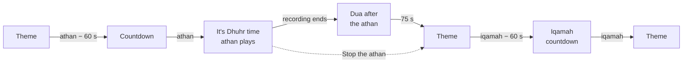

# Adhan Clock

A prayer-time clock for a wall-mounted tablet, in the spirit of the Masjidal
Athan Clock: full-screen themes, Arabic calligraphy for each prayer, the athan
with a dua afterwards, and a quiet night mode for the bedroom.

Live: **https://adhan-clock-fs.web.app**

It is a static web app. Prayer times are calculated on the tablet from its
location ([adhan-js](https://github.com/batoulapps/adhan-js)); settings,
uploaded photos and uploaded recordings stay in that tablet's browser. There is
no account and no server.

## What it shows

| Screen | When |
|---|---|
| **Calligraphy** | From each athan for a set time (45 min by default): a photo for the time of day, the prayer's name in gold calligraphy, "It's Dhuhr time", the current and next prayer in a dial, sunrise/sunset, weather. |
| **Classic**, **Kids** or **Gallery** | The rest of the day (your choice). Classic: clock card, five prayer cards, countdown medallion, verse/hadith/dua of the day. Kids: cartoon sky, cards, reminders on the grass. Gallery: a calendar-style rotation of captioned photographs (mosques of the world, treasures of Islamic civilization, manuscripts, lands of Islam) with the prayer times along the foot. |
| **Night** | From an hour after Isha until Fajr: a dim, drifting clock with the Fajr and last-third-of-night times. |
| **Athan sequence** | One-minute countdown, then the athan with "It's Dhuhr time", then the dua after the athan, then the final minute before iqamah. |



Settings → Display → *Motion: Calm* stops the slow photo zoom, light rays and
drifting clouds for slower tablets.

Also: Jumu'ah times (Friday Dhuhr becomes Jumu'ah), Duha and sunrise screens,
an optional Tahajjud athan at the start of the last third of the night, a notice
during the makruh times, Ramadan countdowns to suhoor and iftar with the iftar
dua, and the Hijri date with a day adjustment.

## Setting up the tablet

1. Install **Fully Kiosk Browser** (Android).
2. Set the start URL to `https://adhan-clock-fs.web.app`.
3. In Fully's settings enable:
   - *Web Content Settings → Autoplay Audio* (the athan plays without a tap),
   - *Advanced Web Settings → Enable JavaScript Interface* (night dimming of the backlight),
   - *Device Management → Keep Screen On* and *Launch on Boot*,
   - *Web Content Settings → Enable Geolocation* (for "Use this tablet's location").
4. Open the page, choose the location, then tap the faint gear on the left edge
   to adjust the calculation method, iqamah offsets, Jumu'ah, sounds and
   themes. **Settings → Preview** plays any prayer's full sequence immediately.

Without Fully Kiosk, use Chrome's *Add to Home screen*: the clock runs full
screen and offline, but after each restart the athan needs one tap to be
allowed to play (a "Tap to enable athan sound" badge appears).

## Development

```bash
npm install
npm run dev            # http://localhost:5173
npm test               # unit tests (schedule state machine, prayer times)
npm run build          # type-check + production build to dist/
npm run test:e2e       # Playwright against the production build
```

Time travel for development: `?now=2026-10-29T12:34:30` starts the clock at a
local time, `&speed=60` runs it 60x faster.

`node tests/visual/shoot.mjs <outDir> 'name=now=2026-10-29T12:50:00;{"dayTheme":"kids"}'`
renders scenarios to PNGs at tablet size (dev server must be running).

### Content and assets

Everything bundled is generated by scripts so it can be rebuilt and checked:

| Asset | Script | Source |
|---|---|---|
| `src/content/*.json` | `uv run scripts/content/build.py` | Quran (Tanzil Uthmani, Saheeh International) and hadith (hadith-api, sahih/hasan only) by reference from `selection.json` |
| `public/audio/` | `uv run scripts/audio/process.py` | Athan recordings, loudness-normalized; synthesized chime |
| `public/backgrounds/` | `uv run scripts/backgrounds/process.py` | Photos per time of day, cropped to 16:10 WebP |
| `public/calligraphy/` | (optional) | Vector calligraphy artwork per prayer (`<id>.svg` + `index.json` with `aspect`), used as gold/ink masks; empty by default, the fonts are used instead |
| `public/gallery/` | `uv run scripts/gallery/process.py` | Gallery photographs with captions from the source catalogues |
| `public/art/rays.webp` | `uv run scripts/art/rays.py` | Light-ray texture |

Credits for photos and recordings are in each folder's `CREDITS.md`.

### Deployment

Every push to `main` runs unit tests, the build and the Playwright suite in
GitHub Actions, then deploys to Firebase Hosting (project `adhan-clock-fs`).
Authentication is keyless: the workflow's OIDC token is exchanged through
Workload Identity Federation for a deployer service account that only this
repository can use.
