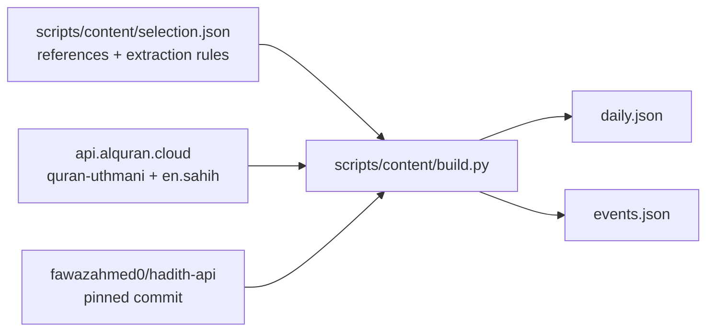

# Religious-text content

`daily.json` and `events.json` are generated. Do not edit them by hand: change
`scripts/content/selection.json` and rebuild.



## Files

- `daily.json`: array of `{id, type, arabic, english, ref}` for the rotating
  verse / hadith / dua panel; `type` is `ayah`, `hadith` or `dua`. About 30 of
  each, ordered ayah, hadith, dua, ayah, ... English is at most 230 characters
  and Arabic at most 200.
- `events.json`: `duaAfterAthan`, `iftarDua`, `suhoorReminder`, `fajrTagline`
  and `prayerTaglines.{dhuhr,asr,maghrib,isha,jumuah,tahajjud,duha}`, each
  `{arabic, english, ref}`. Tagline English is at most 60 characters.

## Rebuild

```sh
uv run scripts/content/build.py            # fetch (cached), validate, write
uv run scripts/content/build.py --check    # exit 1 if these files are stale
uv run scripts/content/build.py --show     # print every passage for review
uv run scripts/content/build.py --tokens   # indexed Arabic tokens, for "words"
```

Downloads are cached in `~/.cache/adhan-clock-content` (`--cache DIR` to
change, `--offline` to use only the cache). The script uses only the Python
standard library.

The build fails unless every item has Arabic, English and a reference, the
Arabic contains Arabic letters and no Latin, the English contains no Arabic, no
narrator chain or unbalanced brackets/quotes, lengths are within limits, ids
are unique, no source is used twice, each daily type has 25 to 35 items and the
event keys are complete.

## Sources and editions

**Quran.** `https://api.alquran.cloud/v1/ayah/{s}:{a}/editions/quran-uthmani,en.sahih`.
Arabic is the Uthmani text of the Tanzil Project as served by alquran.cloud
(an earlier Tanzil revision: it marks iqlab with U+06ED small low meem and
writes some hamzas standalone). English is the Saheeh International
translation. The API prefixes ayah 1 of every surah except 1 and 9 with the
basmala; the build removes it, after checking it letter by letter against 1:1.
Surah names in references are the API's `englishName`.

**Hadith.** `fawazahmed0/hadith-api` at commit
`df57907be35291c91ad6a6691180e22ca9920784`, read from raw.githubusercontent.com
(`editions/{eng,ara}-{book}/{n}.json`, grades and numbering from
`info.min.json`). The English editions are the sunnah.com texts; hadith-api
names Muhsin Khan (Bukhari) and Abdul Hamid Siddiqui (Muslim) as translators
and lists the others as unknown.

- Only Sahih al-Bukhari and Sahih Muslim, or Sunan Abi Dawud / Jami'
  at-Tirmidhi hadith that every grader recorded by hadith-api grades sahih or
  hasan. The grade shown in the reference is Al-Albani's.
- References use sunnah.com numbering. For Sahih Muslim that is the Abd
  al-Baqi number plus variant letter (`2564c`); hadith-api numbers Muslim
  sequentially and keeps the Abd al-Baqi number as `arabicnumber` (`2564.03`).
  The build maps one to the other and fails if the fetched record carries a
  different number. hadith-api's `arabicnumber` is not always sunnah.com's:
  "O Turner of the hearts" (sunnah.com Muslim 2654) is filed under 2655, and
  the record filed as 2709a holds sunnah.com 2708b and 2709a together. Check a
  new Muslim reference against sunnah.com before adding it.

## How passages are extracted

The selection names a source and, where needed, the passage:

- Hadith: the Arabic is the first segment in quotation marks (sunnah.com marks
  the Prophet's words this way), so the isnad and the narrator's framing are
  left out; `ar.quote` picks another segment. English is chosen with
  `en.quote` or with `en.from` / `en.to` anchors that must occur in the
  fetched text.
- `ar.words: [start, end]` slices the Arabic into whitespace tokens. A
  word-sliced passage is part of a longer ayah or hadith and its reference
  starts with "From". For ayahs, English may drop only the translator's
  `[bracketed]` framing while the Arabic stays whole; any other English cut
  requires the matching Arabic cut, and the build enforces this.
- Changes to the fetched text are limited to: whitespace and bidi marks,
  quotation marks and pause marks at the edges of an Arabic passage, curly
  quotes to straight quotes, backtick (used for ayn) to U+02BF, a space before
  punctuation, a quote mark left unmatched at the edge of an excerpt, an
  upper-case first letter and a final full stop (hadith-api drops closing
  punctuation).
- `fajrTagline` is the athan phrase taken from Sunan Abi Dawud 504; its
  reference is given as "From the Fajr athan".

## Licensing

- Quran Arabic: Tanzil Quran Text, Creative Commons Attribution 3.0. Verbatim
  copying only; the source (Tanzil Project) must be indicated with a link to
  https://tanzil.net. alquran.cloud asks that reproductions keep the
  diacritics and orthography of the Uthmani text and are not mixed with
  non-Quranic text in a way that could be mistaken for the Quran.
- Saheeh International translation: copyright of its publisher. Tanzil
  distributes it for non-commercial use only; other use needs the publisher's
  permission. alquran.cloud asks that republished translations credit the
  translator.
- hadith-api: the repository is released under the Unlicense. The hadith
  translations it collects keep the rights of their translators and
  publishers.

The app must show the references and credit Tanzil, Saheeh International and
hadith-api / sunnah.com where it displays these texts.
